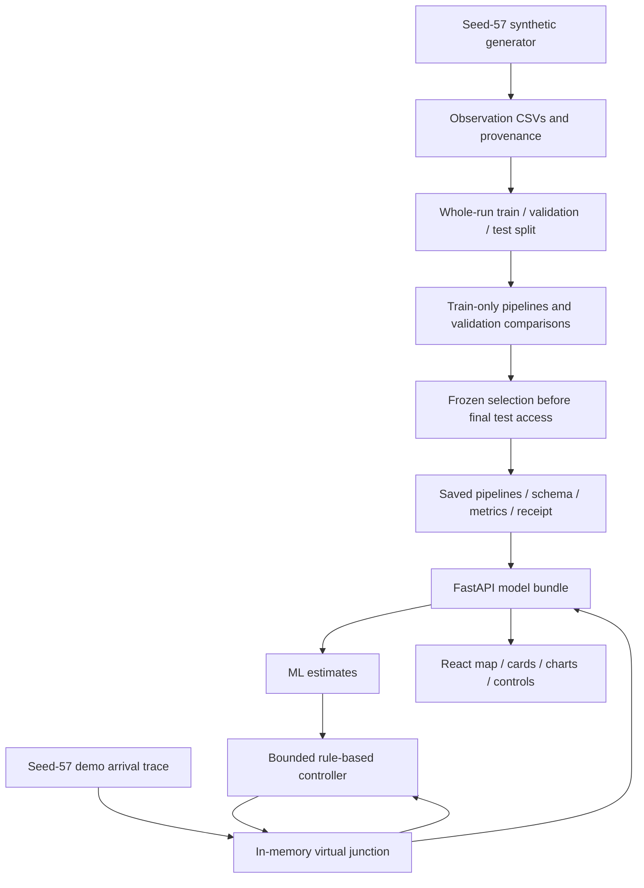
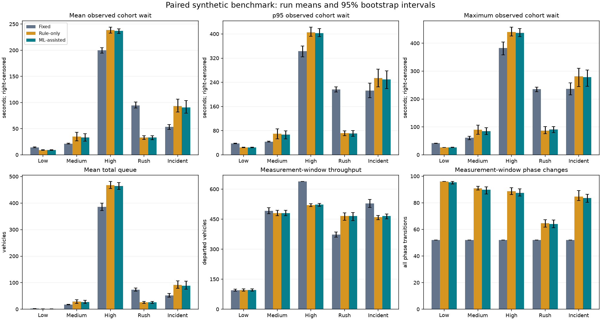
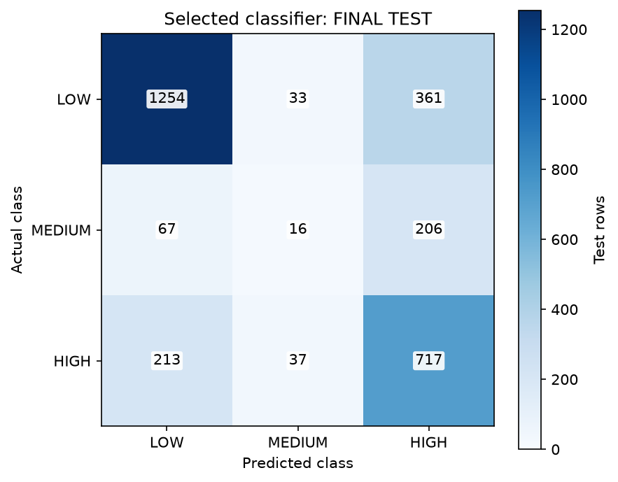

# Raah — virtual traffic ML lab

Raah is an educational semester project using **synthetic GPS-like aggregate speed,
counts and queues** to estimate congestion and future queue wait. A separate,
constrained rule-based controller adjusts **VIRTUAL signals only**. Seed: **57**.
Every provisional syllabus topic remains **UNVERIFIED**; no complete coverage is claimed.

Documentation refreshed **2026-11-03 (Asia/Calcutta)** from current code and saved
artifacts. Latest final acceptance on 2026-11-03: **657 Python tests passed,
1 SUMO skip; 42 client tests passed; client build passed**. See the current
[handoff and acceptance receipt](docs/HANDOFF.md); [final QA](docs/FINAL_QA_REPORT.md)
retains the earlier 2026-11-02 audit and its original test count.

For the repeatable **three-minute presentation**, use [the demo script](docs/DEMO_SCRIPT.md).
`simulation/walkthrough.py --verify --allow-rule-fallback --output artifacts/demo-take-001`
verifies matching arrivals in a private service instance; `--serve --port 5173` serves
the built client/API and saved evidence figures together. Prefix either invocation
with the project venv Python. Use a fresh verifier output directory for another take.
Browser screenshots remain unverified; a [capture checklist](docs/SCREENSHOT_CHECKLIST.md)
is supplied. Saved clustering/PCA plots are evidence views, not a live analysis panel.

## Implementation status

| Implemented | Boundary / missing feature |
| --- | --- |
| Four-approach synthetic generator, grouped raw splits, train-only pipelines, provisional model comparisons, one frozen final assessment | No real private GPS, real traffic measurements or GPS-only validation |
| FastAPI inference, model information, cached evidence and bounded simulation endpoints | Shared single-user in-memory state; no authentication, multi-user isolation, database or persistence across restart |
| React/Vite dashboard: map, approach countdowns, speed/queue history, forecasts, saved metrics/comparisons, scenario and controller selection, run/pause/reset | No frontend random traffic; no UI screenshot or real-browser E2E pass available |
| Fixed-time, rule-only and ML-assisted constrained controllers, action logs and paired benchmarks | No RL, deep learning, physical signals, hardware integration, paid services, MongoDB or Stripe |
| Optional feature-gated standalone SUMO fixed-time smoke adapter | SUMO runtime skipped as unavailable at last check; no SUMO ML-adaptive/API integration or automatic OSM-network import |

## Setup and local run

PowerShell, repository root. Inspect `requirements.txt`, `requirements.lock.txt` and
`client/package.json` before installation. Use **Python 3.12** and Node satisfying
`^20.19.0 || >=22.12.0`. The saved environment used Python 3.12.14 and Node 24.22.1.

For a fresh checkout with `python` pointing to Python 3.12:

```powershell
python --version
node --version
npm --version
python -m venv ml-service/.venv
.\ml-service\.venv\Scripts\python.exe -m pip install -r requirements.lock.txt
npm --prefix client ci
```

Reuse an existing working venv; do not replace it unnecessarily. These are setup
instructions, not installations performed during documentation. The lockfile is the
saved resolution; `requirements.txt` permits broader versions if a new resolution
is deliberately required. No privileged installs or login are needed for local use.

Start the API and client in **two separate terminals**:

```powershell
# Terminal 1
.\ml-service\.venv\Scripts\python.exe -m uvicorn app.main:app --app-dir ml-service --host 127.0.0.1 --port 8000 --workers 1
```

```powershell
# Terminal 2
npm --prefix client run dev
```

Open <http://127.0.0.1:5173>; API docs: <http://127.0.0.1:8000/docs>.
Stop each server with Ctrl+C. Vite's development `/api` proxy strips that prefix
and forwards to the backend. Root `.env.example` documents shell variables and is
not automatically loaded. `client/.env.example` may be copied to `client/.env.local`;
all `VITE_` values are public build-time configuration, never secrets.

If npm is absent from PATH in the existing development workspace, the installed
fallback is `node work/tools/npm/package/bin/npm-cli.js --prefix client ...`.
That ignored local tool is **not shipped with a clone**; normally install/use Node's npm.

### Model artifacts are a separate prerequisite

`artifacts/` is Git-ignored. A fresh clone contains synthetic CSVs/splits but **does
not include trained joblib models or cached experiment artifacts**. Restore only a
trusted, version-matched artifact bundle for predictions and saved metrics. Without
it, fixed/rule-only simulation still works; forecasts show unavailable, inference
returns 503, and ML mode requires explicit queue-only fallback. `/health` is liveness,
not model readiness. Read `/model-info` and `/model-metrics` too.

See [deployment notes](docs/DEPLOYMENT_NOTES.md) for required artifact files, CORS,
static builds and readiness. Do not rerun or erase the consumed final-test protocol
merely to make a missing-artifact demo appear ready.

## Architecture



The diagram shows data/control roles; the main simulator never depends on SUMO.
Models estimate state, not unconstrained phase commands. Fixed and rule-only modes
can display advisory forecasts without using them for decisions. Polling is sequential,
aborts on cleanup, ignores stale responses and does not retry failed mutations.
One in-flight tick may complete after Pause. A configuration change needs Reset.

| Code | Role |
| --- | --- |
| `simulation/generate_data.py` | Offline dataset generator and source/phase audit exports |
| `ml-service/app/schemas.py`, `ml-service/data/schema.json` | Strict units/ranges, cross-field/label validation |
| `ml-service/training/` | Run splits, train-only transforms, supervised/unsupervised experiments, frozen evaluation |
| `simulation/controllers.py` | Shared legal phase state machine, bounded policies and reason logs |
| `simulation/demo.py`, `simulation/benchmark.py` | Online virtual demo and offline paired benchmark |
| `ml-service/app/main.py`, `models.py`, `simulation_api.py`, `dashboard_api.py` | Inference, atomic simulation actions and verified saved metrics |
| `client/src/` | Backend-driven dashboard, Leaflet, Recharts; current HTTP calls use fetch |

## Dataset and leakage boundary

Generator version `point-queue-v1`: **30 runs**, six per low/medium/high/asymmetric
rush-hour/incident demand archetype, one abstract junction, four inbound approaches.
There are **14,520 labeled rows**, **15,240 source snapshots**, **30 metadata rows**
and a **20-row tiny sample** under `ml-service/data/`. The unit is one
run/time/intersection/approach. Simulated physics uses 1-second ticks; observation
snapshots use 10 seconds, t=0..1200; sources extend to t=1260 for exact future labels.
Flow counters describe the completed `(t-10,t]` window. Speed is km/h, waiting is
seconds, counts/queues are vehicles. Missing sampled speed is null, not zero.

GPS-like speeds are noisy synthetic samples. Counts, queues, wait, reference speed
and phase are simulator truth/configuration, not measured private GPS. Class totals:
LOW **6,985**, MEDIUM **1,491**, HIGH **6,044**. Balanced scenarios do not balance labels.

`congestion_level` is a current deterministic index: HIGH for queue >=10, wait >=60 s,
or speed/reference <=0.35 when count >=5; otherwise MEDIUM for queue >=5, wait >=30 s,
or ratio <=0.70 with count >=5; otherwise LOW. Speed conditions are absent if no samples.
`future_wait_seconds` is mean queued-vehicle wait at the **same group's exact t+60**
snapshot, not total trip delay. Feature-derived labels can inflate apparent accuracy;
group splitting alone does not remove their circular definition.

Authoritative `split_manifest.json`: **18/6/6 whole runs**, **8,712/2,904/2,904 rows**,
no overlap. Identifiers, future outcomes and targets never enter model inputs.
Classification excludes the direct label-rule fields and GPS sample-count proxy:
it uses `incoming_vehicles`, `outgoing_vehicles`, `current_phase`, `seconds_in_phase`,
`time_of_day`. Regression uses the 11 current features listed in
`training/prepare_data.py`, including current wait for a fair persistence baseline.
Imputers/encoders/scalers/polynomial transforms fit training data only during comparison.
No grouped hyperparameter search was implemented; any future tuning requires grouped folds.

Historical EDA used 20/5/5 groups. The later split protects final test from prior
EDA training; two current validation groups were explored before. Validation is
an exposed development set. See [leakage audit](docs/LEAKAGE_AUDIT.md),
[data dictionary](docs/DATA_DICTIONARY.md) and [generator contract](simulation/README.md).

## Saved model comparisons

These are **saved validation** results from `artifacts/classification/model_comparison.csv`
and `artifacts/regression/regression_comparison.csv`: train 18 runs; validate six runs.
All candidates remain **PROVISIONAL / syllabus UNVERIFIED**.

| Model (all provisional) | Validation accuracy | Macro-F1 | MEDIUM recall | Saved single-row median ms |
| --- | ---: | ---: | ---: | ---: |
| LogisticRegression | 0.700069 | 0.489339 | 0.000000 | 3.412 |
| KNN | 0.704890 | 0.537601 | 0.086142 | 3.215 |
| GaussianNB | 0.662190 | 0.472884 | 0.014981 | 3.093 |
| SVC | 0.730372 | 0.510306 | 0.000000 | 3.268 |
| DecisionTreeClassifier | 0.724518 | 0.509029 | 0.003745 | 2.865 |
| RandomForestClassifier | 0.729683 | 0.526603 | 0.026217 | 8.385 |

Macro-F1 gives each class equal weight. SVC's higher accuracy does not overcome its
zero MEDIUM recall. Frozen final selection ranks macro-F1 first, then minimum/mean
class recall, latency and name for exact ties. **KNN** was selected. The earlier
development stability-band rule is distinct; the frozen manifest is authoritative.
Latency above is a historical measurement, not a cross-machine guarantee.

| Model | Validation MAE s | RMSE s | R2 | Saved fit time s | Negative predictions |
| --- | ---: | ---: | ---: | ---: | ---: |
| last_observed_wait | 10.102998 | 13.315676 | 0.971812 | 0.0000 | 0 |
| linear_regression | 7.017311 | 9.549969 | 0.985501 | 0.0499 | 350 |
| polynomial_degree2 | 6.139516 | 8.390615 | 0.988808 | 0.0744 | 289 |

Only the two explicitly requested fitted regressors are compared; persistence is
a reference. The fitted candidates rank by MAE, then RMSE: **polynomial_degree2**.
Polynomial expansion is degree 2 on numeric inputs only; categorical phase is one-hot
encoded. Negative outputs are retained and flagged, not hidden by clipping.

### One saved final assessment — not rerun for documentation

Selection was frozen before test access. Complete selected pipelines were then
refitted on train+validation: **24 groups / 11,616 rows**. Final test: **six groups /
2,904 rows**. The receipt records one original CSV read and one prediction batch per
model. The API checks the saved metrics hash against that COMPLETE receipt.

- KNN: accuracy **0.684229**, macro-F1 **0.503522**; MEDIUM recall
  **0.055363** (16/289). This is weak minority-class performance.
- Polynomial: MAE **5.973365 s**, RMSE **8.190121 s**, R2 **0.985745**;
  **441 negative predictions** left raw under the frozen policy.

Source: `artifacts/final/metrics.json`, `selection_manifest.json`,
`test_access_claim.json`; [final test audit](docs/FINAL_TEST_AUDIT.md).
Model version: `e3605e36e02326835d0e762e6a0ddb5cba435968523c74988bd4f6516155f85c`. Do not tune on these consumed test results.

### Unsupervised exploration

Train-only K-Means, hierarchical clustering, DBSCAN and PCA are implemented as
provisional candidates. Saved PCA first-two-component explained variance is
**0.563375**. Cluster IDs are arbitrary, not congestion truth. DBSCAN silhouette
is undefined when only one non-noise cluster exists. IQR/z-score branches are
evidence-gated and **SKIPPED_UNVERIFIED** in the saved experiment; no outlier filtering
or cluster-based control is implemented. See [findings](docs/UNSUPERVISED_FINDINGS.md).

## Virtual controller rules and assumptions

Legal cycle: `ns_green -> ns_yellow -> all_red_to_ew -> ew_green -> ew_yellow -> all_red_to_ns`.
No direct conflicting green transition. Demo/benchmark defaults:

| Setting | Value |
| --- | ---: |
| Minimum / maximum green | 15 / 60 s |
| Fixed-time green | 30 s |
| Yellow / all-red | 3 / 1 s |
| Maximum continuous axis red | 75 s |
| Adaptive extension step | <=5 s |
| Pedestrian WALK / clearance | 7 / 8 s |
| ML maximum estimate age / required horizon | 10 / 60 s |

Effective green floor is max(minimum green, WALK+clearance). Rules protect that
floor, reserve outgoing clearance before the red deadline, enforce maximum green,
then permit a bounded extension when active-axis pressure exceeds the other by >1.
Rule-only pressure sums current queues. ML adds a bounded supplement from valid
congestion/wait estimates (weight 3); it cannot override phase/safety constraints.
Bad/stale/future/mixed-version/negative estimates use queue-only rules in the controller;
the API refuses ML operation unless fallback is explicitly permitted or estimates are valid.
Every action records its reason and evidence.

Pedestrians assume parallel crossings, no turns and no late WALK entry. These are
illustrative virtual assumptions, not real-road-safe universal timings. A bounded red
does not bound vehicle waiting when demand exceeds capacity. **Offline training data
uses a different fixed baseline: generated 25–40 s greens, 3 s yellow, 2 s all-red**;
do not conflate the generator with demo/controller/benchmark dynamics.

## Saved paired benchmark

Sources: `artifacts/benchmark/run_manifest.json`, `summary.csv`, `run_metrics.csv`,
`paired_runs.csv`. Five scenarios x five derived seeds = **25 identical-arrival
traces**, three policies = **75 rollouts**; **180 s warm-up + 600 s measurement**.
Run-level 95% bootstrap intervals use 2,000 resamples, seed 57. Tables below average
the five independent runs; waits are finite-horizon, **right-censored** observations.

| Scenario | Fixed-time mean wait s | Rule-only mean wait s | ML-assisted mean wait s |
| --- | ---: | ---: | ---: |
| low | 14.237 | 9.157 | 9.498 |
| medium | 21.549 | 35.038 | 33.213 |
| high | 200.151 | 238.509 | 236.920 |
| asymmetric_rush_hour | 94.355 | 33.177 | 33.123 |
| incident | 53.342 | 93.520 | 90.891 |

There were **0 constraint violations**, maximum observed axis red **68 s**,
and **30/50 adaptive-vs-fixed pairs had worse mean wait**. Both adaptive
policies are worse in all medium/high/incident pairs. ML fallback averages **25.8%**
of its run ticks including warm-up. This supports scenario-specific comparisons,
not universal improvement. The QA repeat verified **116 byte-identical artifacts**.
See [benchmark findings](docs/BENCHMARK_FINDINGS.md) and [QA](docs/FINAL_QA_REPORT.md).

## Existing figures and screenshot status

No verified dashboard screenshot is available. Earlier browser attempts were
blocked; no screenshots were fabricated. The following are **copies of saved
analysis plots, not UI screenshots**, and require no new evaluation:



Takeaway: adaptive policies help the rush-hour scenario but have adverse medium,
high and incident cases; intervals and censoring matter.



Takeaway: MEDIUM is poorly recognized despite moderate overall accuracy.

## API and checks

| Method / endpoint | Behavior |
| --- | --- |
| GET `/health`, `/model-info`, `/model-metrics` | Liveness; pipeline readiness/schema; hash-checked saved aggregate evidence |
| POST `/predict/congestion`, `/predict/wait`, `/predict/batch` | Strict observation contract; batch 1–100; invalid 422; unavailable 503 |
| GET `/simulation/config`, `/simulation/state` | Defaults/options; current shared virtual state |
| POST `/simulation/reset`, `/simulation/step` | Validated reset; generation/expected-tick guarded atomic step, max 100 ticks/request |
| GET / POST `/simulation/benchmark` | Cached / execute capped paired demo comparison; distinct from the 75-rollout offline benchmark |

```powershell
.\ml-service\.venv\Scripts\python.exe ml-service/smoke_imports.py
.\ml-service\.venv\Scripts\python.exe -m pytest -q
npm --prefix client test
npm --prefix client run build
.\ml-service\.venv\Scripts\python.exe tests/check_api_runtime.py
.\ml-service\.venv\Scripts\python.exe tests/check_simulation_runtime.py
```

Tests cover leakage/group overlap, transform fitting, reproducibility, schema/input
ranges, model failures, controller invariants/fairness, polling cleanup and map
attribution. Final-evaluation tests use temporary fixtures, not a new real test run.
Windows asyncio tests need local loopback networking; failure to permit it previously
stalled event-loop startup. Test servers stop in finally blocks. For controlled new
train/validation experiments, see [deployment/reproduction notes](docs/DEPLOYMENT_NOTES.md).

## Limits and presentation guide

Synthetic dynamics and derived labels do not demonstrate live sensing or causal
real-world traffic benefit. Current wait is highly persistent, making R2 alone
misleading. MEDIUM recall is weak; regression can be negative; model transfer to the
different demo physics is limited. Point queues, small run counts, EDA exposure,
censored waits, single-worker shared state and machine-dependent timing remain.

- [20 viva Q&As](docs/VIVA_NOTES.md)
- [Demonstration script](docs/DEMO_SCRIPT.md)
- [Provisional syllabus evidence map](docs/SYLLABUS_COVERAGE_REPORT.md)
- [Deployment and artifact notes](docs/DEPLOYMENT_NOTES.md)
- [Optional SUMO setup/status](docs/SUMO_SETUP.md)

Historical phase reports describe their stage of implementation; this README and
the current code describe today's functionality. All syllabus verification remains
pending the official syllabus. Real signal control is outside the project scope.
